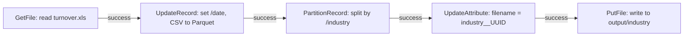

# ETL Pipeline with Apache NiFi

A small Apache NiFi flow that reads a file, adds a date field, converts the records to Parquet, partitions them by `industry`, and writes one output file per partition. Built as a practical lab for a university data course.

## Flow



## Processors

| Processor | Role in the flow | Key settings in the template |
|---|---|---|
| `GetFile` | Picks up the input file from a local directory | Input Directory, File Filter `turnover.xls`, Keep Source File `true`, scheduled every 9000 s |
| `UpdateRecord` | Sets a `/date` field on each record, reads CSV and writes Parquet | Reader: `CSVReader`, Writer: `ParquetRecordSetWriter`, value `${now():format("yyyy-MM-dd:mm:ss")}` |
| `PartitionRecord` | Groups records by the `industry` field and emits one FlowFile per value | Reader: `ParquetReader`, Writer: `ParquetRecordSetWriter`, dynamic property `industry = /industry` |
| `UpdateAttribute` | Renames each FlowFile to `<industry>__<UUID>` | `filename = ${industry}__${UUID()}` |
| `PutFile` | Writes each FlowFile to a directory named after its industry | Directory `.../data/output/${industry}`, Create Missing Directories `true` |

Controller services included in the template: `CSVReader`, `ParquetReader`, and `ParquetRecordSetWriter`.

## Import and run

The template was exported from NiFi 1.x. Templates were removed in NiFi 2.x, so use a 1.x instance for the XML.

1. Start NiFi. With Docker, for example:
   ```bash
   docker run --name nifi -p 8443:8443 apache/nifi
   docker logs nifi 2>&1 | grep -i "generated"   # username and password
   ```
   Open `https://localhost:8443/nifi`. Any other NiFi 1.x install works the same way.
2. Upload the template: open the top-right menu, choose **Templates**, then **Upload Template**, and select `templates/reliability_project.xml`.
3. Add it to the canvas: drag the **Template** icon from the toolbar onto the canvas and pick `reliability_project`.
4. Enable the controller services: right-click the process group, open **Configuration**, then **Controller Services**, and enable `CSVReader`, `ParquetReader`, and `ParquetRecordSetWriter`.
5. Point the paths at your machine. The template uses the author's home directory:
   - `GetFile` → **Input Directory**: a folder containing your input file.
   - `PutFile` → **Directory**: an output folder (the `${industry}` part stays).
6. Create the input folder and put the source file in it. The file filter expects `turnover.xls`, and the reader is CSV, so the file needs CSV-formatted content.
7. Start the processors. `GetFile` runs every 9000 seconds in the template, so lower its scheduling period while testing.

## What I learned

- Building a NiFi flow from processors, relationships and connections.
- Using the NiFi Expression Language to set attributes and values dynamically.
- Record-based processing: reading CSV, writing Parquet, and partitioning by a field.
- Exporting a flow as a template (XML) and versioning it in Git.
- Basic data-pipeline ideas: partitioning, compression trade-offs (Snappy vs GZIP), and possible improvements (automated deployment, more threads, failure logging).

## Known gaps

- The lab report also describes `ConvertRecord` and `CompressContent` (Snappy/GZIP) steps, and an `ingestion_timestamp` column. The exported template contains neither: it sets a `/date` field instead, and has no compression step. The diagram above shows the template as it is.
- The `/date` format string is `yyyy-MM-dd:mm:ss`. In NiFi's date format `mm` means minutes, so the hour is missing. `HH` was probably intended.

## Repository layout

```
docs/
  etl-nifi-report-fr.pdf          Lab report (French)
templates/
  reliability_project.xml         NiFi template (import into NiFi 1.x)
  reliability_project.json        Same flow exported as JSON
```

## Report

The full lab report, in French, is at [docs/etl-nifi-report-fr.pdf](docs/etl-nifi-report-fr.pdf).
